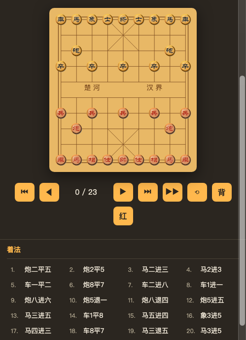
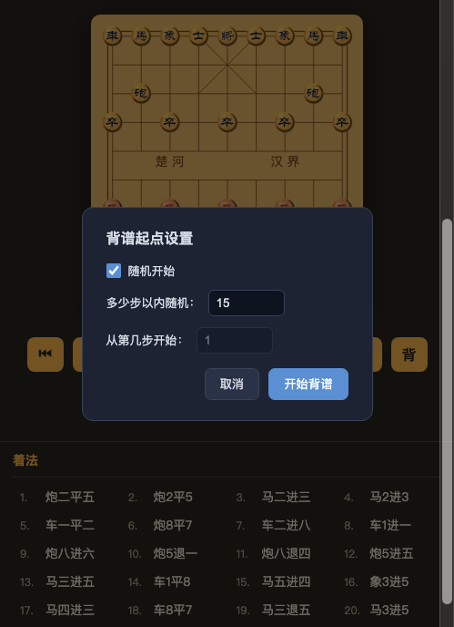

# 中国象棋棋谱浏览器 · 象棋打谱 / 背谱 / 开局学习工具

一个基于 Web 的**中国象棋棋谱在线阅读、打谱与背谱工具**。内置 **8000+ 局经典棋谱**（XQF 格式），支持**开局分类检索**、**残局排局复盘**、**背谱记忆**、**分叉变着浏览**，帮助棋友提升棋力、精研定式、记忆经典名局。

> 项目棋谱来自： https://github.com/zhengguozi/chess_book/ 

> 项目主页：https://jeapedu.com/chess

---

## ✨ 核心功能

### 📖 海量棋谱 · 开局分类检索
全库约 **8557 局**中国象棋棋谱，一键按**一级/二级开局**过滤定位：

- **开局定式**：中炮局、飞相局、仙人指路、起马局、过宫炮局、仕角炮局、上士局、其它炮局……
- **二级体系**：中炮对屏风马、中炮对顺炮、中炮对反宫马、仙人指路对卒底炮、中炮进三兵对屏风马……
- **经典古籍**：全局（橘中秘、事林广记）、残局（适情雅趣）、排局（江湖八大排局：七星聚会、炮炸两狼关、三军保驾）
- **实战对局**：比赛对局、象甲联赛、大师专集、近代国手名局、让子局、实战中局夺子取胜技巧 150 局

### 🧠 背谱模式 · 帮你背棋谱（核心亮点）
- 点「**背**」进入背谱模式，可设置**起点步数**（默认 15 步内随机开始）
- **自己动手走子**：走对了自动继续；走错了即时提示「原谱第 N 步应为 XX」
- 支持**红方视角 / 黑方视角**切换：红视角红人工走、黑自动应；黑视角反之
- 适合背开局定式、背残局杀法、记忆经典对局，快速提升棋力

### 🎬 打谱复盘 · 分叉变着
- SVG 棋盘逐步行棋，支持**前后步 / 首末 / 自动播放 / 键盘方向键**
- **分叉/变着支持**：残局排局中的多分支着法以绿色标记，点击即可进入该分支
- 棋盘可**红黑翻转**，方便从对手视角换角度思考
- 行棋提示、棋谱注解、棋谱内标题完整展示

### 📱 多端适配 · 分享讨论
- 桌面端**左右分栏**（棋盘 + 着法谱同屏）；手机端纵向布局自动适配
- 点开棋谱地址栏带 `#path=` 链接，**分享即直达同一棋谱**，方便棋友讨论
- 「**上一谱 / 下一谱**」连续浏览，开局过滤 + 分类树快速导航

---

## 🖼 界面截图

<div align="center">
  
  
  <br/>
  <em>棋盘打谱界面（左） · 背谱模式起点设置（右）</em>
</div>

---

## 🚀 快速开始

```bash
# 1. 安装依赖（仅需 cchess 一个库）
pip install cchess

# 2.（可选）预生成开局分类索引（全库约 700 秒，生成后分类/过滤秒开）
python3 build_index.py

# 3. 启动服务
python3 server.py 8945

# 4. 浏览器访问
open http://127.0.0.1:8945/
```

> 提示：不运行 `build_index.py` 也能打谱浏览，但开局过滤与分类视图会提示先生成索引。

---

## 🔧 技术栈

- **后端**：Python 标准库（`http.server`）＋ 复用 `cchess` 库解析 XQF
- **前端**：原生 JavaScript ＋ SVG，无框架，零额外依赖
- **开局识别**：基于红方第一步 + 前 8 步主变自动判定一级/二级开局

## 📁 目录结构

```
chess_book/
├── server.py            # HTTP 服务：目录树 / 棋谱解析 / 开局索引 API + 静态前端
├── cchess/              # XQF 解析库（复用，不改）
├── openings.py          # 开局分类：一级 detect_opening + 二级 detect_opening2
├── build_index.py       # 索引构建：全库多进程扫描 -> index.json
├── index.json           # 开局索引（一级 opening + 二级 opening2，全库）
├── web/
│   ├── index.html       # 页面骨架（棋谱库 / 分类 tab、目录树、棋盘、控制条）
│   ├── chess.css        # 样式（含分类视图、背谱弹窗、移动端适配）
│   └── app.js           # 前端逻辑（棋盘渲染、双视图、分类树、背谱、分叉）
└── docs/
    ├── 设计文档.md        # 详细架构设计文档
    └── screenshots/      # 界面截图
```

## 📚 棋谱分类说明

库中棋谱按书籍/主题分门别类，整个作为一本书：

1. **比赛对局**（象甲联赛、冠军赛、大师专集、近代国手名局、让子局）
2. **残局**（适情雅趣、实战中局夺子取胜技巧 150 局等）
3. **全局**（橘中秘、事林广记等经典古谱）
4. **布局**（中炮对屏风马、中炮对反宫马等开局体系）
5. **未分类**

## 🤝 说明与致谢

- 棋谱来自网络公开合集，仅供象棋爱好者学习研究使用
- 极少数棋谱文件无法解析（约 19/8557，0.2%）已在索引中跳过
- 开局自动识别与分类由 `openings.py` 完成，详情见 `docs/设计文档.md`
- 项目在前人布局基础上，重点增强了**背谱记忆**与**开局分类检索**能力

**愿你棋力精进，常开胜局！♟**
